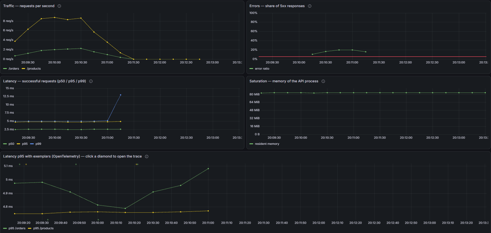
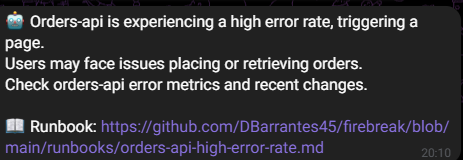
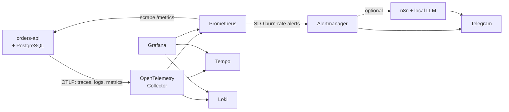

# Firebreak

A self-hosted reliability platform: observability, SLOs as code and
automated incident response — validated by breaking it on purpose.

Most monitoring setups are never tested. You find out an alert doesn't fire
during the incident it was supposed to catch. Firebreak ships with its own
victim app, `orders-api`, which can be told to fail in specific ways (errors,
latency, memory leaks), so every dashboard, SLO and alert can be proven to
work.



A minute later the alert reaches Telegram, summarised by a local LLM and with
its runbook link:



## Quick start

You need Docker with Compose v2 and about 4 GB of free memory.

```bash
git clone https://github.com/DBarrantes45/firebreak.git && cd firebreak
scripts/init-env.sh                    # .env with a random password per service
docker compose up -d --build --wait
scripts/generate-traffic.sh 5          # something for the dashboards to show
```

Open Grafana at <http://localhost:3000> (user `admin`, password
`GRAFANA_ADMIN_PASSWORD` in `.env`) and look for **orders-api — Golden
signals** in the Firebreak folder. To get alerts on your phone, see
[Telegram](platform/alertmanager/secrets/README.md).

## What's inside



- **Observability:** metrics, logs and traces tied together by `trace_id`, so a
  spike on a dashboard leads to the exact trace and its log lines.
- **SLOs as code:** availability (99.9%) and latency (99% under 250 ms),
  generated by [Sloth](https://sloth.dev/) into multi-window burn-rate alerts,
  each with a [runbook](runbooks/).
- **Proven:** chaos game days, load tests and a CI job that takes the API down
  and checks the alert fires.
- **Optional automation:** n8n asks a local LLM for a plain-language summary of
  each alert, and restarts the API on its own behind fixed guardrails.
- **Kubernetes too:** its own Helm chart and kube-prometheus-stack on kind.

More in the [architecture overview](docs/architecture.md).

## Game day results

Each game day breaks one thing on purpose under steady user traffic and
times how long it takes to notice and recover. MTTD runs from injection to
alert; MTTR from injection to healthy again. Run one with
`scripts/gameday.sh GD-0N`.

| Scenario | Alerted? | MTTD | MTTR | Postmortem |
| :--- | :--- | :--- | :--- | :--- |
| [GD-01: 20% of requests fail](gamedays/GD-01-error-spike.md) | Yes | ~2.5 min | ~2.5 min | — |
| [GD-02: 30% of requests are slow](gamedays/GD-02-slow-requests.md) | Yes, slower than expected | ~8.5 min | ~9 min | — |
| [GD-03: memory leak](gamedays/GD-03-memory-leak.md) | Yes | ~2 min | ~2.5 min | — |
| [GD-03 with auto-restart](gamedays/GD-03-memory-leak.md#rerun-with-automation-phase-8) | Yes, fixed by the bot 7 s later | 107 s | 115 s | — |
| [GD-04: database down](gamedays/GD-04-database-down.md) | Not at first, yes after the fix | 2 min | 6 min | [Outage went unnoticed](postmortems/2026-10-25-database-outage-went-unnoticed.md) |
| [GD-05: database frozen](gamedays/GD-05-database-frozen.md) | Yes | <1 min | ~1 min | — |
| [GD-06: slow network to the database](gamedays/GD-06-slow-network.md) | Not at first, yes on the rerun | ~2 min* | 2 min | — |

\* Flattering: the first run had already filled the alert window. From a
healthy hour, latency incidents take around 10 minutes to page, as GD-02
shows.

Capacity: about 300 requests per second within the SLOs, limited by the API's
CPU ([capacity report](loadtests/CAPACITY-REPORT.md)).

## Monitor your own service

Adding a service is adding one file to `platform/prometheus/targets/`:

```yaml
- targets: ["my-service:8080"]
  labels:
    service: my-service
```

Prometheus picks it up within seconds, without a restart, and alerts if it
stops answering. See the [guide](docs/monitor-your-own-service.md).

## Security

- Every port listens on `127.0.0.1` only; nothing is reachable from your
  network.
- No default passwords: `init-env.sh` generates them, and Compose refuses to
  start without them.
- `/admin/chaos` doesn't exist unless `FIREBREAK_CHAOS_ENABLED=true`; it
  answers 404, not 403.
- The automation layer restarts containers through a socket proxy that
  allows nothing else, never through the Docker socket itself.

Not covered: TLS and authentication in front of the ports. Firebreak assumes a
single trusted machine; put a reverse proxy in front before exposing it.

## Operations

- **Retention:** Prometheus 30 days or 2 GB, Loki 14 days, Tempo 7 days.
- **Limits:** every container has a memory limit, so a leak can't take down
  the monitoring watching it (tested: only the leaking API went down).
- **Backup and restore:** `scripts/backup.sh` and `scripts/restore.sh`.
  Drill-tested: every volume deleted and restored in **30 seconds**
  ([how](docs/how-to/backup-and-restore.md)).

## Stability

From 1.0.0, Firebreak follows [Semantic Versioning](https://semver.org/).
These are the public API, and only a new major version changes them in a
breaking way:

| Surface | What stays stable |
| :--- | :--- |
| Environment variables | The names in `.env.example` |
| Targets contract | `platform/prometheus/targets/*.yml`, its format and the required `service` label |
| Metrics and labels | `http_requests_total`, `http_request_duration_seconds` and their `route`, `status`, `traffic` labels; `job` and `service` |
| Published ports | 3000, 3100, 3200, 5432, 5678, 8000, 9090, 9093 on `127.0.0.1` |
| Dashboard UIDs | `golden-signals`, `slo-orders-api` |
| Helm chart values | The keys in `deploy/k8s/charts/orders-api/values.yaml` |

Anything else, such as alert thresholds, internal file layout or image
versions, can change in any release. The [changelog](CHANGELOG.md) lists every
change.

## More

- [Run it locally](docs/how-to/run-locally.md): start, stop, reset, chaos.
- [Incident automation](docs/how-to/incident-automation.md): n8n, Ollama and the guarded auto-restart.
- [Run it on Kubernetes](docs/how-to/run-on-kubernetes.md): kind, the Helm chart and kube-prometheus-stack.
- [Endpoints and ports](docs/reference/endpoints-and-ports.md): every URL in one table.
- [SLOs](slos/README.md) and the [error budget policy](docs/error-budget-policy.md).
- [Runbooks](runbooks/), [game days](gamedays/) and [postmortems](postmortems/).

## Built with

[FastAPI](https://fastapi.tiangolo.com/), [PostgreSQL](https://www.postgresql.org/),
[Prometheus](https://prometheus.io/), [Grafana](https://grafana.com/oss/grafana/),
[Loki](https://grafana.com/oss/loki/), [Tempo](https://grafana.com/oss/tempo/),
[OpenTelemetry](https://opentelemetry.io/), [Sloth](https://sloth.dev/), [k6](https://k6.io/),
[n8n](https://n8n.io/), [Ollama](https://ollama.com/), [kind](https://kind.sigs.k8s.io/),
[Helm](https://helm.sh/) and
[kube-prometheus-stack](https://github.com/prometheus-community/helm-charts/tree/main/charts/kube-prometheus-stack).

## License

[MIT](LICENSE). n8n, used by the optional automation layer, is under its own
[Sustainable Use License](https://docs.n8n.io/sustainable-use-license/).
