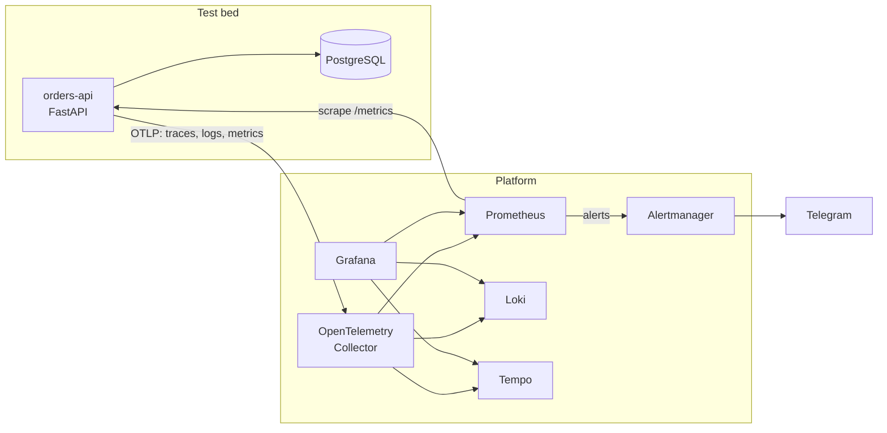
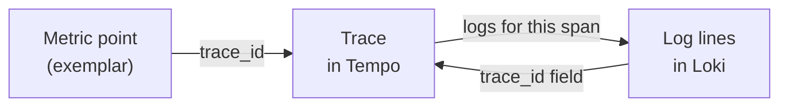
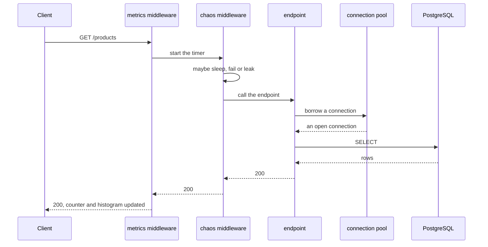

# Architecture

Firebreak is two things living in one repo.

The **platform** (`platform/`) is the part meant to last: the observability
stack today, alerting and incident automation later. The plan is for it to
end up watching the services in a homelab.

The **test bed** (`app/`) is `orders-api`, a deliberately small service that
can be told to misbehave. It exists for one reason: to prove the platform
notices when something breaks.

## The pieces

The app speaks one protocol, OTLP, to one place, the Collector. The Collector
decides where each signal goes. Swapping Tempo for something else, or adding
a second backend, is a YAML change rather than a code change.

## When something breaks

Prometheus evaluates the alert rules every 15 seconds: the SLO burn-rate
alerts generated by Sloth, plus `OrdersApiDown`, which catches the one case
the SLO alerts can't see (no data at all). Firing alerts go to Alertmanager,
which groups them, silences the ones that add nothing (a dead service makes
its SLO alerts pointless) and sends them to Telegram. Pages ring; tickets
arrive silently. Every alert links to its runbook in [`runbooks/`](../runbooks).

## How each signal travels

Metrics take two roads on purpose. The app exposes its own request counters
and latency histogram at `/metrics`, and Prometheus scrapes them every 15
seconds. These are the numbers the SLOs will be built on, because scraping
gives you `up` for free: if the app dies, Prometheus knows. The OpenTelemetry
SDK also pushes its standard HTTP metrics through the Collector. Those carry
exemplars, which is what lets a dashboard link straight to a trace.

Traces come from OpenTelemetry's automatic instrumentation of FastAPI and
psycopg, plus a manual span around taking a connection from the pool. Logs
are plain Python `logging`, written as JSON to stdout and shipped to Loki
over OTLP at the same time.

## One id to tie it all together

Every request gets a `trace_id`, and it shows up everywhere: on metric
exemplars, on every span, on every log line.

In Loki it is stored as structured metadata, not as a label. A label with one
value per request would create millions of tiny streams and grind the index
to a halt.

## Life of a request

The metrics middleware sits on the outside so it also counts the failures
the chaos middleware injects. Put it on the inside and the dashboards would
report a healthy service while it was falling over.
